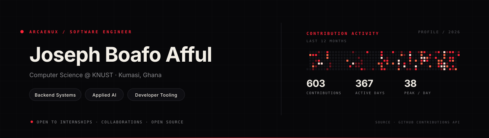

## About

I'm **Joseph Boafo Afful** (`arcaenux`), a computer science student at **KNUST** in Kumasi, Ghana. I work on **backend systems**, **developer tooling**, and **applied AI**, with a focus on software that is clear, reliable, and useful.

I'm currently open to **internships**, **collaborations**, and **open-source work**. The best way to reach me is through an issue on this repository.

## At a glance

| | |
|:---|:---|
| **Based in** | Kumasi, Ghana |
| **Education** | Computer Science, KNUST |
| **Focus** | Backend systems · Applied AI · Developer tooling |
| **Open to** | Internships · Collaborations · Open source |

---

## Selected projects

### [mindstep](https://github.com/arcaenux/mindstep)
Mental-health literacy platform for Ghana. Includes 24 topic cards across nine themes, voice and text input, practice conversations, and a vetted support directory. Designed to work without accounts, paywalls, or personal data collection.

`TypeScript` · `React` · `Vite`

### [course-rundown](https://github.com/arcaenux/course-rundown)
Interactive study environment for university courses. Includes formula calculators, exam banks, timed simulators, and a C++ memory and pointer visualizer built around actual course material.

`TypeScript` · `React` · `Education`

### [SaveDat](https://github.com/arcaenux/SaveDat)
A Java CLI for locating files that would be lost if a single drive failed. Matches copies by content rather than filename and operates read-only so it cannot damage source data.

`Java` · `CLI` · `Systems`

### [RepoClue](https://github.com/arcaenux/RepoClue)
A Python CLI for discovering, evaluating, and organizing public GitHub repositories from the terminal. Covers the research stage before cloning.

`Python` · `CLI` · `Developer tooling`

Additional repositories: [mern-chat](https://github.com/arcaenux/mern-chat) · [qr_scanner](https://github.com/arcaenux/qr_scanner) · [Axellemd_projects](https://github.com/arcaenux/Axellemd_projects)

---

## Technical stack

| Layer | Technologies |
|:---|:---|
| **Application** | React · Next.js · Django · Vite |
| **Languages** | TypeScript · JavaScript · Python · Java · C++ |
| **Data** | MongoDB · PostgreSQL · SQLite |
| **Runtime & tooling** | Node.js · Express · Vercel · Git · Linux |

---

## GitHub activity

<table>
<tr>
<td width="50%"></td>
<td width="50%"></td>
</tr>
</table>

---

## Contact

I'm most responsive through GitHub. Open an issue for collaborations, project questions, or anything worth building.

Profile assets are generated from real GitHub activity by <a href="./build_assets.py"><code>build_assets.py</code></a> and refreshed by <a href="./refresh_data.py"><code>refresh_data.py</code></a>.
