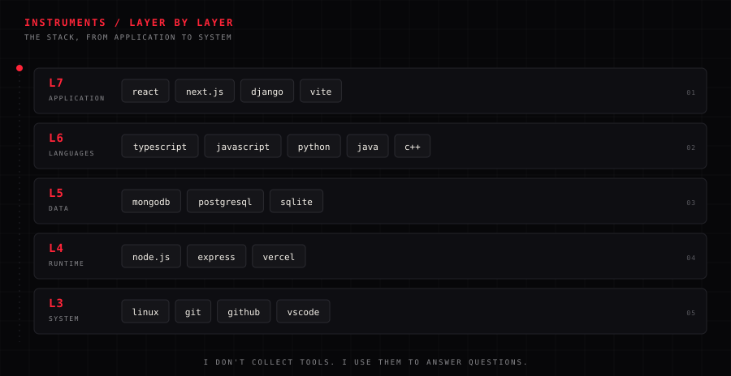

 

  

## `01 / IDENTITY`

I'm **Joseph Boafo Afful** — **Arcaenux** online. A computer science student at **Kwame Nkrumah University of Science and Technology (KNUST)** in Ghana, building software to understand how systems behave.

I care about the layer underneath: how the algorithm scales, how the request travels, why the abstraction leaks. My interests sit where **software engineering**, **algorithms**, and **applied AI** meet — with a soft spot for **backend systems** and **developer tooling**.

I learn by building. Everything here is part of the loop: **learn → build → break → investigate → rebuild.**

| STATUS | DETAIL |
|:--|:--|
| **Studying** | Computer Science @ KNUST |
| **Building** | tools that make hard things legible |
| **Exploring** | algorithms · backend architecture · applied AI |
| **Open to** | collaboration · open source · interesting problems |

## `02 / STACK`

I don't collect tools. I use them to answer questions.

## `03 / SELECTED WORK`

A few things I've built, broken, and learned from.

| # | PROJECT | WHAT IT IS | STACK |
|:--:|:--|:--|:--|
| 01 | **[mindstep](https://github.com/arcaenux/mindstep)** [live demo ↗](https://mindstep-eight.vercel.app) | A free mental-health literacy app for Ghana — 24 topic cards across nine themes, voice and text, practice conversations, and a checked support directory. No accounts. No paywall. | TypeScript · Next.js · Three.js |
| 02 | **[course-rundown](https://github.com/arcaenux/course-rundown)** [live demo ↗](https://course-rundown.vercel.app) | An interactive study room built around real course material: formula calculators, exam banks, timed simulators, and a C++ memory/pointer visualizer. Five course rooms and counting. | TypeScript · Next.js · Postgres |
| 03 | **[SaveDat](https://github.com/arcaenux/SaveDat)** *in progress* | A Java CLI that finds the files you'd lose if one drive failed — matching copies by content, not filename. Read-only by design. | Java · CLI · File systems |
| 04 | **[RepoClue](https://github.com/arcaenux/RepoClue)** *in progress* | A Python CLI for discovering, evaluating, and organizing public GitHub repositories without leaving the terminal. | Python 3.11+ · CLI |

Also building: **[mern-chat](https://github.com/arcaenux/mern-chat)** ([live](https://mern-chat-astrolab.vercel.app)), **[qr_scanner](https://github.com/arcaenux/qr_scanner)** ([live](https://qr-scanner-henna-pi.vercel.app)), and a shelf of small front-end experiments in **[Axellemd_projects](https://github.com/arcaenux/Axellemd_projects)**.

## `04 / TELEMETRY`

The work, as GitHub sees it.

<table align="center">
<tr>
<td width="50%"></td>
<td width="50%"></td>
</tr>
</table>

<picture>
<source media="(prefers-color-scheme: dark)" srcset="https://raw.githubusercontent.com/arcaenux/arcaenux/output/github-snake-dark.svg" />
<source media="(prefers-color-scheme: light)" srcset="https://raw.githubusercontent.com/arcaenux/arcaenux/output/github-snake.svg" />

</picture>

## `05 / THE LOOP`

> **Learn it. Build it. Break it. Understand it.**
>
> I don't trust knowledge I haven't used. Every project here started as a question I couldn't answer by reading alone — so I built the smallest real thing that could teach me the answer.

- **Go one layer down.** The framework is not the system.
- **Ship the smallest real version.** A working prototype beats a perfect plan.
- **Write down what broke.** Understanding is the only thing that compounds.

## `06 / CONNECT`

I'm always up for a conversation about systems, algorithms, developer tooling, or something you're building. The fastest way to reach me is an issue on this repo.

Joseph Boafo Afful · Ghana · Built with curiosity and a little bit of obsession.

