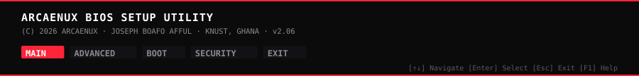

▶ [MAIN] System Information

I'm **Joseph Boafo Afful** — **Arcaenux** online. A computer science student at **Kwame Nkrumah University of Science and Technology (KNUST)** in Ghana, building software to understand how systems behave.

I care about the layer underneath: how the algorithm scales, how the request travels, why the abstraction leaks. My interests sit where **software engineering**, **algorithms**, and **applied AI** meet — with a soft spot for **backend systems** and **developer tooling**.

I learn by building. Everything here is part of the loop: **learn → build → break → investigate → rebuild.**

▶ [ADVANCED] Peripheral Configuration

I don't collect tools. I use them to answer questions.

| Layer | Components |
|:---|:---|
| **L7 Application** | React · Next.js · Django · Vite |
| **L6 Languages** | Java · Python · C++ · TypeScript · JavaScript |
| **L5 Data** | MongoDB · PostgreSQL · SQLite |
| **L4 Runtime / Infra** | Node.js · Express · Vercel |
| **L3 OS & Tooling** | Linux · Git · GitHub · VS Code |

▶ [BOOT] Boot Device Priority

| Priority | Device | Project | Purpose |
|:---:|:---|:---|:---|
| **01** | /dev/sda1 | [mindstep](https://github.com/arcaenux/mindstep) | Free mental-health literacy app for Ghana — 24 topic cards across nine themes, voice and text, practice conversations, checked support directory. No accounts. No paywall. |
| **02** | /dev/sda2 | [course-rundown](https://github.com/arcaenux/course-rundown) | Interactive study rooms built around real course material — formula calculators, exam banks, timed simulators, C++ memory/pointer visualizer. |
| **03** | /dev/sda3 | [SaveDat](https://github.com/arcaenux/SaveDat) | Java CLI that finds the files you'd lose if one drive failed — matching copies by content, not filename. Read-only by design. |
| **04** | /dev/sda4 | [RepoClue](https://github.com/arcaenux/RepoClue) | Python CLI for discovering, evaluating, and organizing public GitHub repositories without leaving the terminal. |

Also loading: [mern-chat](https://github.com/arcaenux/mern-chat) · [qr_scanner](https://github.com/arcaenux/qr_scanner) · [Axellemd_projects](https://github.com/arcaenux/Axellemd_projects)

▶ [SECURITY] Access Log

<table align="center">
<tr>
<td width="50%"></td>
<td width="50%"></td>
</tr>
</table>

<picture>
<source media="(prefers-color-scheme: dark)" srcset="https://raw.githubusercontent.com/arcaenux/arcaenux/output/github-snake-dark.svg" />
<source media="(prefers-color-scheme: light)" srcset="https://raw.githubusercontent.com/arcaenux/arcaenux/output/github-snake.svg" />

</picture>

▶ [EXIT] Save & Exit

I'm always up for a conversation about systems, algorithms, developer tooling, or something you're building. The fastest way to reach me is an issue on this repo.

Joseph Boafo Afful · Ghana · Built with curiosity and a little bit of obsession.

