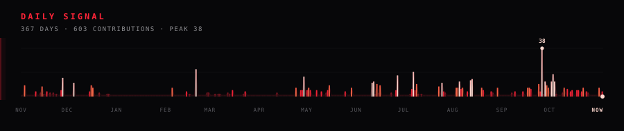

## 00 — SIGNAL

I build systems to understand them. Not the demo — the layer underneath.

How the request travels. Where the algorithm bends. Why the abstraction leaks.

I'm **Joseph Boafo Afful** — **arcaenux** — a computer science student at **KNUST, Ghana**. My work sits where software engineering, algorithms, and applied AI meet, with a bias toward backend systems and developer tooling.

This page is a signal from the middle of that process. It changes as I do.

> Make it work. Make it clear. Make it fast — in that order.

## 01 — COORDINATES

| | |
|:---|:---|
| **Identity** | Joseph Boafo Afful · arcaenux |
| **Coordinates** | Kumasi, Ghana · 6.6885° N, 1.6244° W |
| **Education** | BSc Computer Science · KNUST |
| **Focus** | Software engineering · Algorithms · Applied AI · Backend systems |
| **Currently** | Building in public, one system at a time |
| **Open to** | Collaborations · Internships · Hard problems |

## 02 — INSTRUMENTS

I don't collect tools. I use them to answer questions.

| Layer | Components |
|:---|:---|
| **L7 · Application** | React · Next.js · Django · Vite |
| **L6 · Languages** | TypeScript · JavaScript · Python · Java · C++ |
| **L5 · Data** | MongoDB · PostgreSQL · SQLite |
| **L4 · Runtime** | Node.js · Express · Vercel |
| **L3 · System** | Linux · Git · GitHub · VS Code |

Currently deepening: distributed systems · applied AI · developer tooling.

## 03 — ARTIFACTS

### 001 · [mindstep](https://github.com/arcaenux/mindstep)
**Mental-health literacy for Ghana.** 24 topic cards across nine themes, voice and text, practice conversations, and a checked support directory. No accounts. No paywall. Built to be useful on a bad day, not to collect data.

`TypeScript` · `React` · `Vite`

### 002 · [course-rundown](https://github.com/arcaenux/course-rundown)
**Interactive study rooms.** Formula calculators, exam banks, timed simulators, and a C++ memory/pointer visualizer — built around real course material instead of generic flashcards.

`TypeScript` · `React` · `Education`

### 003 · [SaveDat](https://github.com/arcaenux/SaveDat)
**A Java CLI that finds the files you'd lose if one drive failed.** Matches copies by content, not filename. Read-only by design, because a safety tool should never be the reason you lose something.

`Java` · `CLI` · `Systems`

### 004 · [RepoClue](https://github.com/arcaenux/RepoClue)
**Discover, evaluate, and organize public GitHub repositories from the terminal.** A Python CLI for the part of research that happens before you clone.

`Python` · `CLI` · `Developer tooling`

Also in the archive: [mern-chat](https://github.com/arcaenux/mern-chat) · [qr_scanner](https://github.com/arcaenux/qr_scanner) · [Axellemd_projects](https://github.com/arcaenux/Axellemd_projects)

## 04 — TELEMETRY

<table>
<tr>
<td width="50%"></td>
<td width="50%"></td>
</tr>
</table>

## 05 — TRANSMISSION

The fastest way to reach me is an issue on this repo. I'm always up for a conversation about systems, algorithms, developer tooling, or something you're building.

## 06 — COLOPHON

The hero is a **phyllotaxis**: every day of the last year placed at the golden angle, radius by `√(day / 365)`, size and heat by contribution count. The bloom rotates once every three minutes. The pulse, spectrum, and stack are generated from the same real data by [`build_assets.py`](./build_assets.py) and refreshed by [`refresh_data.py`](./refresh_data.py), then committed as SVG. No third-party banner services. No stock templates.

Type: monospace + Georgia. Palette: `#070709` / `#FF2438` / `#F4F0E8`.

<code>// EOF</code>

If you're reading this, you're the kind of person I want to build with. Open an issue. Tell me what you're working on.

Joseph Boafo Afful · Ghana · Built with curiosity and a little bit of obsession.

